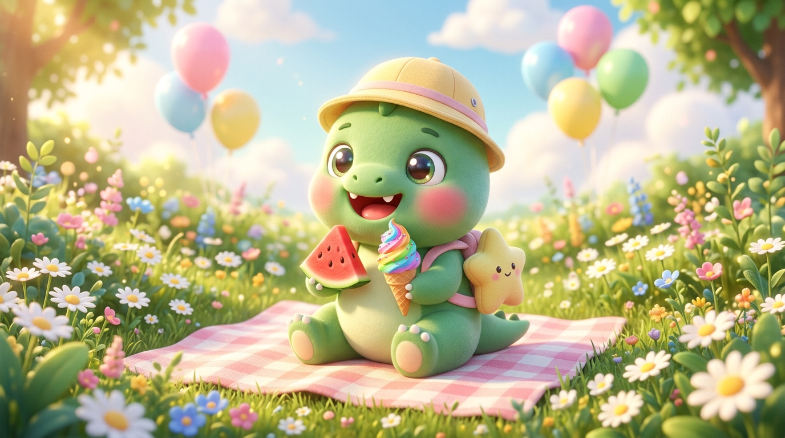
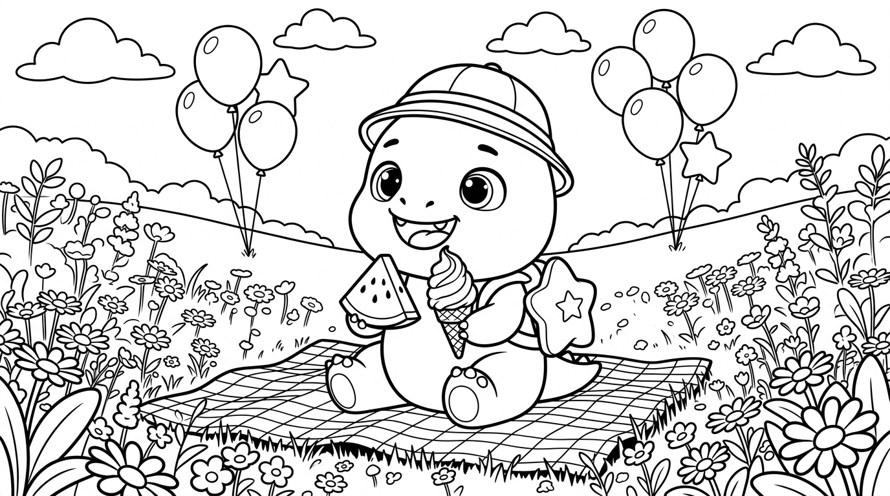

# 🎨 Kids Coloring Book Maker

> Transform any cartoon screenshot, game moment, family photo, or pet picture into crisp, kid-friendly coloring pages using Multimodal AI (Google Nano Banana / Imagen / Gemini).

[](https://opensource.org/licenses/MIT)
[](SKILL.md)
[](https://www.python.org/)

---

## 💡 Why This Project?

Every parent, teacher, or caregiver has encountered this challenge:
* Children often ask to color their favorite niche cartoon scene, video game moment, pet photo, or vacation memory — but **commercial coloring books simply don't have them**.
* Traditional image filters (like grayscale filters or OpenCV Canny edge detection) produce noisy artifacts, shadow gradients, and broken lines that make coloring frustrating for young kids.

By leveraging **Multimodal Generative AI (such as Google Nano Banana / Imagen)** with semantic scene understanding, the AI acts like a professional children's book illustrator:
1. **Understands Scene Semantics**: Identifies main characters, props, and facial expressions while ignoring noisy textures and shadows.
2. **Bold & Closed Contours**: Delivers thick, clean, closed boundary lines that prevent marker and crayon color bleed.
3. **Pure White Fills (Zero Shading)**: Strips out all grayscale, gradients, and halftones, leaving wide-open spaces perfect for markers, colored pencils, and crayons.

---

## ✨ Showcase: Before & After (100% Royalty-Free)

| Original Reference Image | Converted Kid-Friendly Coloring Page |
| :---: | :---: |
|  |  |

> **Showcase**: *Kawaii Baby Dinosaur Picnic* ➡️ Transformed into an easy-to-color, bold line art page for ages 3–7, preserving the bucket hat, star backpack, watermelon, ice cream, and sunny daisy meadow with clean closed contours!

---

## 📦 What's Included

1. **AI Agent Skill (`SKILL.md`)**:
   * Drop-in skill for Antigravity, Cursor, Claude Code, or any agent-based coding assistant.
   * Just upload an image and say: *"Convert this picture into a coloring page for kids."*
2. **Printable A4 PDF Exporter (`scripts/export_a4_pdf.py`)**:
   * Lightweight Python utility that converts any line art into a print-ready 300 DPI A4 PDF with proper margins.
   * Comes with pre-generated sample: `assets/dinosaur_coloring_page_A4.pdf`.
3. **Prompt Engineering Recipe**:
   * Tested and validated prompt structure for Nano Banana, Imagen 3, and DALL-E.

---

## 🚀 Quick Start

### Option 1: Use as an AI Agent Skill (Antigravity / Cursor / Claude)

Copy `SKILL.md` into your agent skills directory:

```bash
# For Antigravity global skills:
mkdir -p ~/.gemini/config/skills/kids-coloring-book
cp SKILL.md ~/.gemini/config/skills/kids-coloring-book/
```

Then in your agent chat, simply attach an image and say:
> *"Transform this image into a children's coloring book page!"*

---

### Option 2: Export Print-Ready A4 PDF via Python

Once you have a generated line art image, generate an A4 PDF with one command:

```bash
python scripts/export_a4_pdf.py assets/example_coloring.jpg my_coloring_sheet.pdf
```

* **Orientation**: Defaults to Landscape (standard for wide game/photo scenes). Supports Portrait as well.
* **Resolution**: Standard 300 DPI print quality with safe margins.

---

## 🧠 The Prompt Formula

To get the cleanest, most printable line art from Google Nano Banana, Imagen, or DALL-E, the secret lies in **strict negative constraints** and **bold contour emphasis**:

```text
Transform this image into a children's coloring book page.
Black and white line art with bold, clear outlines and pure white fills.
No shading, no grayscale, no color, no halftone dots.
The scene features [Describe main characters, their actions and expressions],
[Describe foreground objects], and [Simplified background elements].
Cute, clear, closed contours, and easy to color for young children.
```

### Prompt Do's & Don'ts:
- ❌ **Avoid** words like `sketch` or `pencil drawing` (they introduce messy hatch lines and soft shading).
- ❌ **Avoid** `hyper-realistic` or `detailed texture` (they add micro-details kids cannot color).
- ✅ **Use** `clean line art`, `bold outlines`, `no shading`, `coloring book page for kids`, `closed contours`.

---

## 🤝 Contributing

Contributions are very welcome! Feel free to open issues or PRs:
- Add more tested examples (pets, vehicles, landscapes, cartoon characters)
- Build a lightweight Web UI (Streamlit or Gradio)
- Add more print layouts (e.g. A5 booklet, postcard)

---

## 📄 License

Distributed under the [MIT License](LICENSE). All showcase sample assets in `assets/` are 100% original and free for personal or educational use.
